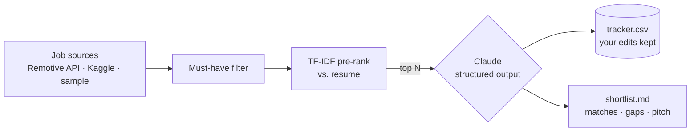

# Job Search Agent


Finds open roles, screens each one against your resume like a recruiter would, and keeps an
application tracker up to date, so you spend time applying instead of scrolling job boards.

Example session (illustrative; figures are not from a recorded run):

```text
$ make run-live
42 jobs found · 31 meet must-haves · scoring 15
                         Shortlist
 fit  title                         company        gaps
 91   Senior Product Analyst        Lumen Pay      Snowflake
 86   AI Product Analyst            Quanta Labs    LLM eval tooling
 ...
9 new jobs added to data/tracker.csv · shortlist saved to reports/shortlist_2026-10-01.md · $0.21
```

> **Live mode needs an Anthropic API key** (`ANTHROPIC_API_KEY`). Everything else (tests, CI, and the similarity-only ranking via `make run-offline`) runs without one.
> Real offline output: [`reports/sample_shortlist_offline.md`](reports/sample_shortlist_offline.md)

## How it works



- **Two-stage ranking** ([`scoring.py`](src/job_agent/scoring.py)): a cheap TF-IDF similarity pass ranks every
  posting; only the top N are sent to Claude, which keeps cost per run to cents
- **Structured output**: Claude returns a JSON-schema-validated fit score, matched skills, gaps,
  dealbreakers and a one-line cover-letter opener, checked with Pydantic
- **Calibrated rubric** in the prompt (85+ apply today, below 50 poor fit, capped if a dealbreaker hits)
- **Tracker that respects you** ([`tracker.py`](src/job_agent/tracker.py)): new jobs are appended, and the
  `status` and `notes` you edit are never overwritten
- **Private by default**: your real resume and preferences live in gitignored files

## Run it

```bash
make setup                 # install dependencies (requires uv)
cp .env.example .env       # add ANTHROPIC_API_KEY (a .env in any parent folder also works)
make profile               # creates profile/resume.md + preferences.json (gitignored), then edit them
make run                   # score the bundled sample jobs
make run-live              # live remote jobs from Remotive
make run-offline           # similarity ranking only, no API key
make test
```

## Data sources

| Source | What | Notes |
|---|---|---|
| `sample` | 6 bundled demo postings | Offline demo and tests |
| `remotive` | Live remote jobs via the [Remotive public API](https://remotive.com/api/remote-jobs) | No key; keep to a few runs per day and credit Remotive |
| `kaggle` | [LinkedIn Job Postings](https://www.kaggle.com/datasets/arshkon/linkedin-job-postings) (~120k) | Needs a one-time `uvx kaggle auth login` |

**Stack:** Python · Claude API (structured outputs) · scikit-learn · Pydantic · pandas · Rich · pytest
